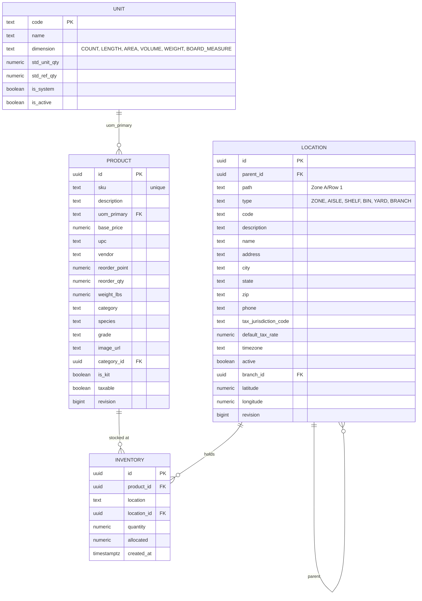
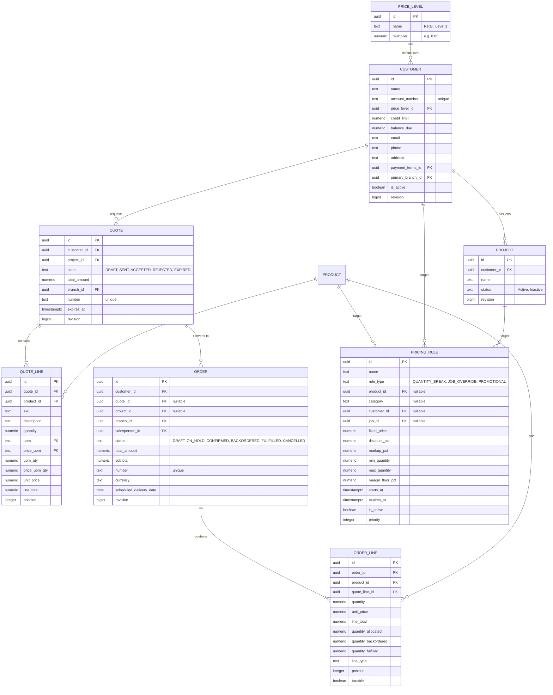
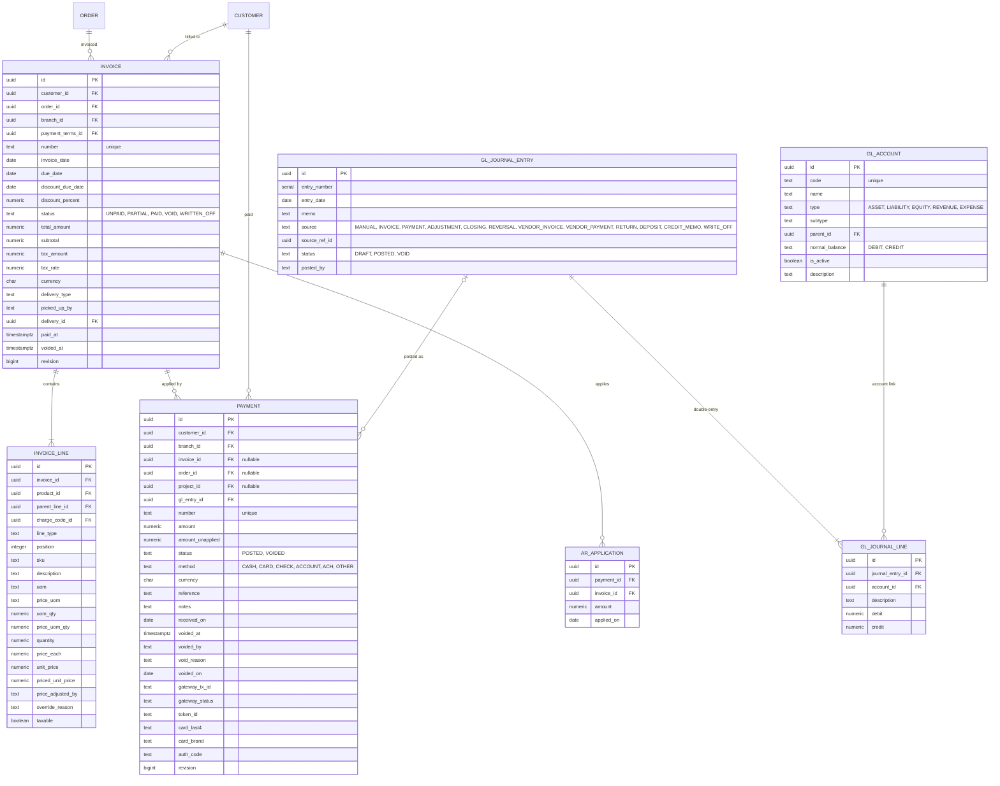

# GableLBM: Database Entity Relationship Diagram

This document defines the physical data model for GableLBM. We prioritize data integrity, unit-awareness, and a "double-entry" ledger for all asset movements (Inventory, Cash, Receivables).

This page covers the inventory, sales and pricing, and finance tables only (19 of the schema's 126 tables). The migrations in `core/migrations` are the source of truth for everything else.

## Core Principles
1. **Primary keys**: the tables on this page use `UUID` keys, except `units`, whose natural key is `code`.
2. **Quantities and money**: physical quantities use `NUMERIC(12,4)`; money totals, balances, payments and ledger amounts use `NUMERIC(12,2)`; unit prices and costs use `NUMERIC(12,4)`. Money is a decimal amount of currency units, not integer cents, with one exception: the freight tables `po_freight_charges` and `po_freight_allocations` store integer cents in `*_cents BIGINT` columns. Check the column in the migrations before building on it.
3. **Stock quantities**: current stock is held in `inventory` rows keyed by `product_id` and `location_id`. The table has no cost column and no foreign key to the ledger.
4. **Unit awareness**: every quantity is paired with a unit code; the catalogue in `core/migrations/099_units_catalogue_and_sets.sql` is the source of truth.

---

## 1. Inventory Module

The Inventory module handles the complexity of LBM products, conversions (Piece to MBF), and multi-yard logistics. The schema records current stock in `inventory` rows keyed by `product_id` and `location_id`; no unique constraint limits it to one row per pair. The unit catalogue in `core/migrations/099_units_catalogue_and_sets.sql` is the source of truth for units.

### Mermaid ERD


### PostgreSQL Schema (Excerpt)

```sql
-- UOM Enum Type (001, dropped in 099 after the units catalogue replaces it)
DO $$ BEGIN
    CREATE TYPE uom_type AS ENUM (
        'PCS','EA','LF','SF','BF','MBF','SQ','BOX','CTN','RL',
        'GAL','LBS','BAG','BUNDLE','PAIR','SET'
    );
EXCEPTION WHEN duplicate_object THEN null; END $$;

-- Products (001, altered through 099)
CREATE TABLE products (
    id UUID PRIMARY KEY DEFAULT uuid_generate_v4(),
    sku TEXT NOT NULL UNIQUE,
    description TEXT NOT NULL,
    uom_primary TEXT REFERENCES units(code),
    base_price NUMERIC(12, 4) NOT NULL DEFAULT 0.0000,
    upc TEXT,
    vendor TEXT,
    reorder_point NUMERIC(12, 4) DEFAULT 0,
    reorder_qty NUMERIC(12, 4) DEFAULT 0,
    weight_lbs DECIMAL(10, 2) DEFAULT 0,
    category VARCHAR(64),
    species VARCHAR(64),
    grade VARCHAR(64),
    image_url TEXT,
    category_id UUID REFERENCES product_categories(id),
    is_kit BOOLEAN NOT NULL DEFAULT FALSE,
    taxable BOOLEAN NOT NULL DEFAULT TRUE,
    revision BIGINT NOT NULL DEFAULT 1,
    created_at TIMESTAMPTZ NOT NULL DEFAULT NOW(),
    updated_at TIMESTAMPTZ NOT NULL DEFAULT NOW()
);

-- Unit catalogue (099). Code is the natural primary key.
CREATE TABLE units (
    code         TEXT PRIMARY KEY CHECK (code ~ '^[A-Z]{1,6}$'),
    name         TEXT NOT NULL CHECK (char_length(name) BETWEEN 1 AND 80),
    dimension    TEXT NOT NULL CHECK (dimension IN ('COUNT','LENGTH','AREA','VOLUME','WEIGHT','BOARD_MEASURE')),
    std_unit_qty NUMERIC(12,4) NULL CHECK (std_unit_qty IS NULL OR std_unit_qty > 0),
    std_ref_qty  NUMERIC(12,4) NULL CHECK (std_ref_qty IS NULL OR std_ref_qty > 0),
    CHECK ((std_unit_qty IS NULL) = (std_ref_qty IS NULL)),
    is_system    BOOLEAN NOT NULL DEFAULT FALSE,
    is_active    BOOLEAN NOT NULL DEFAULT TRUE,
    revision     BIGINT NOT NULL DEFAULT 1,
    created_at   TIMESTAMPTZ NOT NULL DEFAULT NOW(),
    updated_at   TIMESTAMPTZ NOT NULL DEFAULT NOW()
);

-- Locations (002, altered through 093)
CREATE TABLE locations (
    id UUID PRIMARY KEY DEFAULT uuid_generate_v4(),
    parent_id UUID REFERENCES locations(id) ON DELETE RESTRICT,
    path TEXT NOT NULL DEFAULT '',
    type TEXT NOT NULL,                -- 'ZONE','AISLE','SHELF','BIN','YARD','BRANCH'
    code TEXT NOT NULL,
    description TEXT,
    name TEXT,
    address TEXT,
    city TEXT,
    state TEXT,
    zip TEXT,
    phone TEXT,
    tax_jurisdiction_code TEXT,
    default_tax_rate NUMERIC(9,6),
    timezone TEXT NOT NULL DEFAULT 'America/New_York',
    active BOOLEAN NOT NULL DEFAULT TRUE,
    branch_id UUID REFERENCES locations(id) ON DELETE RESTRICT,
    latitude DOUBLE PRECISION,
    longitude DOUBLE PRECISION,
    revision BIGINT NOT NULL DEFAULT 1,
    created_at TIMESTAMPTZ NOT NULL DEFAULT NOW(),
    updated_at TIMESTAMPTZ NOT NULL DEFAULT NOW(),
    UNIQUE(parent_id, code)
);

-- Inventory (001, altered through 099)
CREATE TABLE inventory (
    id UUID PRIMARY KEY DEFAULT uuid_generate_v4(),
    product_id UUID NOT NULL REFERENCES products(id) ON DELETE CASCADE,
    location TEXT NOT NULL,                          -- legacy free-text
    location_id UUID REFERENCES locations(id) ON DELETE RESTRICT,
    quantity NUMERIC(12, 4) NOT NULL DEFAULT 0.0000,
    allocated NUMERIC(12, 4) NOT NULL DEFAULT 0,
    created_at TIMESTAMPTZ,
    updated_at TIMESTAMP WITH TIME ZONE DEFAULT NOW()
);
```

---

## 2. Sales & Pricing Module

The Sales module implements the core pricing waterfall and order management flows. The pricing waterfall is stored in `pricing_rules`; `customer_jobs` was dropped in migration 091 (its rows moved into `projects`).

### Mermaid ERD


### PostgreSQL Schema (Excerpt)

```sql
-- Pricing (003)
CREATE TABLE price_levels (
    id UUID PRIMARY KEY DEFAULT uuid_generate_v4(),
    name TEXT NOT NULL,
    multiplier NUMERIC(12, 4) NOT NULL DEFAULT 1.0000,
    created_at TIMESTAMP WITH TIME ZONE DEFAULT NOW(),
    updated_at TIMESTAMP WITH TIME ZONE DEFAULT NOW()
);

-- Customers (003, altered through 091)
CREATE TABLE customers (
    id UUID PRIMARY KEY DEFAULT uuid_generate_v4(),
    name TEXT NOT NULL,
    account_number TEXT UNIQUE NOT NULL,
    email TEXT,
    phone TEXT,
    address TEXT,
    price_level_id UUID REFERENCES price_levels(id) ON DELETE SET NULL,
    credit_limit NUMERIC(12, 2),
    balance_due NUMERIC(12, 2) NOT NULL DEFAULT 0.00,
    payment_terms_id UUID REFERENCES payment_terms(id),
    primary_branch_id UUID NOT NULL REFERENCES locations(id),
    salesperson_id UUID REFERENCES sales_team(id),
    is_active BOOLEAN DEFAULT TRUE,
    created_at TIMESTAMP WITH TIME ZONE DEFAULT NOW(),
    updated_at TIMESTAMP WITH TIME ZONE DEFAULT NOW(),
    revision BIGINT NOT NULL DEFAULT 1
);

-- Jobs (035 created projects; 091 moved customer_jobs into projects and dropped customer_jobs)
CREATE TABLE projects (
    id UUID PRIMARY KEY,
    customer_id UUID NOT NULL REFERENCES customers(id),
    name VARCHAR(255) NOT NULL,
    status VARCHAR(50) NOT NULL DEFAULT 'Active',
    created_at TIMESTAMP WITH TIME ZONE DEFAULT CURRENT_TIMESTAMP,
    updated_at TIMESTAMP WITH TIME ZONE DEFAULT CURRENT_TIMESTAMP,
    revision BIGINT NOT NULL DEFAULT 1
);

-- The Pricing Waterfall (016, job_id retargeted to projects at 091)
CREATE TABLE pricing_rules (
    id UUID PRIMARY KEY DEFAULT gen_random_uuid(),
    name TEXT NOT NULL,
    rule_type TEXT NOT NULL CHECK (rule_type IN ('QUANTITY_BREAK', 'JOB_OVERRIDE', 'PROMOTIONAL')),
    product_id UUID REFERENCES products(id),
    customer_id UUID REFERENCES customers(id),
    job_id UUID REFERENCES projects(id),
    category TEXT,
    fixed_price NUMERIC(12,4),
    discount_pct NUMERIC(12,4),
    markup_pct NUMERIC(12,4),
    min_quantity NUMERIC(12,4) DEFAULT 0,
    max_quantity NUMERIC(12,4),
    margin_floor_pct NUMERIC(12,4),
    starts_at TIMESTAMPTZ,
    expires_at TIMESTAMPTZ,
    is_active BOOLEAN NOT NULL DEFAULT TRUE,
    priority INTEGER NOT NULL DEFAULT 0,
    created_at TIMESTAMPTZ NOT NULL DEFAULT NOW(),
    updated_at TIMESTAMPTZ NOT NULL DEFAULT NOW()
);

-- Quote state enum (003)
CREATE TYPE quote_state AS ENUM (
    'DRAFT', 'SENT', 'ACCEPTED', 'REJECTED', 'EXPIRED'
);

-- Quotes (003, altered through 091: job_id dropped; project_id added)
CREATE TABLE quotes (
    id UUID PRIMARY KEY DEFAULT uuid_generate_v4(),
    customer_id UUID REFERENCES customers(id) ON DELETE RESTRICT,
    project_id UUID REFERENCES projects(id),
    state quote_state NOT NULL DEFAULT 'DRAFT',
    total_amount NUMERIC(12, 2) NOT NULL DEFAULT 0.00,
    margin_total NUMERIC(12, 2) DEFAULT 0.00,
    branch_id UUID NOT NULL REFERENCES locations(id),
    number TEXT UNIQUE,
    source TEXT NOT NULL DEFAULT 'manual',
    created_by UUID,
    expires_at TIMESTAMP WITH TIME ZONE,
    sent_at TIMESTAMP WITH TIME ZONE,
    accepted_at TIMESTAMP WITH TIME ZONE,
    rejected_at TIMESTAMP WITH TIME ZONE,
    created_at TIMESTAMPTZ NOT NULL DEFAULT NOW(),
    updated_at TIMESTAMP WITH TIME ZONE DEFAULT NOW(),
    revision BIGINT NOT NULL DEFAULT 1
);

CREATE TABLE quote_lines (
    id UUID PRIMARY KEY DEFAULT uuid_generate_v4(),
    quote_id UUID REFERENCES quotes(id) ON DELETE CASCADE,
    product_id UUID REFERENCES products(id) ON DELETE RESTRICT,
    sku TEXT NOT NULL,
    description TEXT NOT NULL,
    quantity NUMERIC(12, 4) NOT NULL,
    uom TEXT NOT NULL REFERENCES units(code),
    price_uom TEXT REFERENCES units(code),
    uom_qty NUMERIC(12, 4) NOT NULL DEFAULT 1,
    price_uom_qty NUMERIC(12, 4) NOT NULL DEFAULT 1,
    unit_price NUMERIC(12, 4) NOT NULL,
    line_total NUMERIC(12, 2) NOT NULL,
    position INTEGER NOT NULL DEFAULT 0,
    customer_note TEXT,
    created_at TIMESTAMP WITH TIME ZONE DEFAULT NOW()
);

-- Orders (004; ON_HOLD added in 071)
CREATE TABLE orders (
    id UUID PRIMARY KEY DEFAULT uuid_generate_v4(),
    customer_id UUID NOT NULL REFERENCES customers(id) ON DELETE RESTRICT,
    quote_id UUID REFERENCES quotes(id) ON DELETE SET NULL,
    project_id UUID REFERENCES projects(id),
    branch_id UUID NOT NULL REFERENCES locations(id),
    salesperson_id UUID REFERENCES sales_team(id),
    number TEXT UNIQUE,
    currency CHAR(3) NOT NULL,
    status TEXT NOT NULL CHECK (status IN ('DRAFT','ON_HOLD','CONFIRMED','BACKORDERED','FULFILLED','CANCELLED')),
    total_amount NUMERIC(12, 2) NOT NULL DEFAULT 0.00,
    subtotal NUMERIC(12, 2) NOT NULL DEFAULT 0,
    delivery_type TEXT NOT NULL DEFAULT 'DELIVERY',
    scheduled_delivery_date DATE,
    packing_manifest JSONB,
    created_at TIMESTAMPTZ NOT NULL DEFAULT NOW(),
    updated_at TIMESTAMP WITH TIME ZONE DEFAULT NOW(),
    revision BIGINT NOT NULL DEFAULT 1
);

CREATE TABLE order_lines (
    id UUID PRIMARY KEY DEFAULT uuid_generate_v4(),
    order_id UUID NOT NULL REFERENCES orders(id) ON DELETE CASCADE,
    product_id UUID REFERENCES products(id) ON DELETE RESTRICT,
    quote_line_id UUID REFERENCES quote_lines(id) ON DELETE SET NULL,
    line_type TEXT NOT NULL DEFAULT 'PRODUCT',
    position INTEGER NOT NULL DEFAULT 0,
    parent_line_id UUID REFERENCES order_lines(id) ON DELETE CASCADE,
    charge_code_id UUID REFERENCES charge_codes(id),
    sku TEXT,
    description TEXT NOT NULL,
    quantity NUMERIC(12, 4),
    unit_price NUMERIC(12, 4),
    priced_unit_price NUMERIC(12, 4),
    price_source TEXT NOT NULL DEFAULT 'PRICE_LIST',
    uom TEXT,
    price_uom TEXT,
    uom_qty NUMERIC(12, 4),
    price_uom_qty NUMERIC(12, 4),
    discount_percent NUMERIC(7, 4),
    discount_amount NUMERIC(12, 2),
    line_total NUMERIC(12, 2),
    quantity_allocated NUMERIC(12, 4) NOT NULL DEFAULT 0,
    quantity_backordered NUMERIC(12, 4) NOT NULL DEFAULT 0,
    quantity_fulfilled NUMERIC(12, 4) NOT NULL DEFAULT 0,
    taxable BOOLEAN NOT NULL DEFAULT TRUE,
    is_special_order BOOLEAN NOT NULL DEFAULT FALSE,
    special_order_cost NUMERIC(12, 4),
    created_at TIMESTAMPTZ NOT NULL DEFAULT NOW()
);
```

---

## 3. Finance & Job Accounting Module

The Finance module handles AR, Invoicing, and a strict double-entry ledger for all financial transactions.

### Mermaid ERD


### PostgreSQL Schema (Excerpt)

```sql
-- Chart of Accounts (025)
CREATE TABLE gl_accounts (
    id UUID PRIMARY KEY DEFAULT gen_random_uuid(),
    code VARCHAR(20) NOT NULL UNIQUE,
    name VARCHAR(100) NOT NULL,
    type VARCHAR(20) NOT NULL CHECK (type IN ('ASSET','LIABILITY','EQUITY','REVENUE','EXPENSE')),
    subtype VARCHAR(50) DEFAULT '',
    parent_id UUID REFERENCES gl_accounts(id),
    normal_balance VARCHAR(10) NOT NULL CHECK (normal_balance IN ('DEBIT','CREDIT')),
    is_active BOOLEAN NOT NULL DEFAULT TRUE,
    description TEXT DEFAULT '',
    created_at TIMESTAMP WITH TIME ZONE DEFAULT NOW(),
    updated_at TIMESTAMP WITH TIME ZONE DEFAULT NOW()
);

-- Invoices (005, altered through 097)
CREATE TABLE invoices (
    id UUID PRIMARY KEY DEFAULT uuid_generate_v4(),
    customer_id UUID NOT NULL REFERENCES customers(id) ON DELETE RESTRICT,
    order_id UUID REFERENCES orders(id) ON DELETE RESTRICT,
    branch_id UUID NOT NULL REFERENCES locations(id),
    number TEXT UNIQUE,
    invoice_date DATE NOT NULL DEFAULT CURRENT_DATE,
    due_date DATE,
    discount_due_date DATE,
    discount_percent NUMERIC(7, 4),
    payment_terms_id UUID NOT NULL REFERENCES payment_terms(id),
    status TEXT NOT NULL CHECK (status IN ('UNPAID','PARTIAL','PAID','VOID','WRITTEN_OFF')),
    total_amount NUMERIC(12, 2) NOT NULL DEFAULT 0.00,
    subtotal NUMERIC(12, 2) DEFAULT 0,
    tax_amount NUMERIC(12, 2) DEFAULT 0,
    tax_rate NUMERIC(9, 6),
    currency CHAR(3) NOT NULL DEFAULT 'USD',
    delivery_type TEXT NOT NULL DEFAULT 'PICKUP',
    picked_up_by TEXT,
    delivery_id UUID REFERENCES deliveries(id) ON DELETE SET NULL,
    paid_at TIMESTAMP WITH TIME ZONE,
    voided_at TIMESTAMPTZ,
    voided_by TEXT,
    void_reason TEXT,
    voided_on DATE,
    created_at TIMESTAMP WITH TIME ZONE DEFAULT NOW(),
    updated_at TIMESTAMP WITH TIME ZONE DEFAULT NOW(),
    revision BIGINT NOT NULL DEFAULT 1
);

CREATE TABLE invoice_lines (
    id UUID PRIMARY KEY DEFAULT uuid_generate_v4(),
    invoice_id UUID NOT NULL REFERENCES invoices(id) ON DELETE CASCADE,
    product_id UUID REFERENCES products(id) ON DELETE RESTRICT,
    parent_line_id UUID REFERENCES invoice_lines(id) ON DELETE CASCADE,
    charge_code_id UUID REFERENCES charge_codes(id),
    line_type TEXT NOT NULL DEFAULT 'PRODUCT',
    position INTEGER NOT NULL DEFAULT 0,
    sku TEXT,
    description TEXT NOT NULL,
    uom TEXT,
    price_uom TEXT,
    uom_qty NUMERIC(12, 4),
    price_uom_qty NUMERIC(12, 4),
    quantity NUMERIC(12, 4),
    price_each NUMERIC(12, 4),
    unit_price NUMERIC(12, 4),
    priced_unit_price NUMERIC(12, 4),
    price_adjusted_by TEXT,
    override_reason TEXT,
    taxable BOOLEAN NOT NULL DEFAULT TRUE,
    created_at TIMESTAMP WITH TIME ZONE DEFAULT NOW()
);

-- Payments (008, altered through 101)
CREATE TABLE payments (
    id UUID PRIMARY KEY DEFAULT uuid_generate_v4(),
    customer_id UUID NOT NULL REFERENCES customers(id),
    branch_id UUID NOT NULL REFERENCES locations(id),
    invoice_id UUID REFERENCES invoices(id) ON DELETE RESTRICT,
    order_id UUID REFERENCES orders(id),
    project_id UUID REFERENCES projects(id),
    gl_entry_id UUID REFERENCES gl_journal_entries(id),
    number TEXT UNIQUE,
    amount NUMERIC(12, 2) NOT NULL CHECK (amount > 0),
    amount_unapplied NUMERIC(12, 2) NOT NULL,
    status TEXT NOT NULL DEFAULT 'POSTED' CHECK (status IN ('POSTED','VOIDED')),
    method TEXT NOT NULL CHECK (method IN ('CASH','CARD','CHECK','ACCOUNT','ACH','OTHER')),
    currency CHAR(3) NOT NULL,
    reference TEXT,
    notes TEXT,
    received_on DATE NOT NULL,
    voided_at TIMESTAMPTZ,
    voided_by TEXT,
    void_reason TEXT,
    voided_on DATE,
    gateway_tx_id VARCHAR(128),
    gateway_status VARCHAR(32),
    token_id VARCHAR(128),
    card_last4 VARCHAR(4),
    card_brand VARCHAR(16),
    auth_code VARCHAR(32),
    created_at TIMESTAMPTZ NOT NULL DEFAULT NOW(),
    updated_at TIMESTAMPTZ NOT NULL DEFAULT NOW(),
    revision BIGINT NOT NULL DEFAULT 1
);

-- AR applications (101)
CREATE TABLE ar_applications (
    id UUID PRIMARY KEY DEFAULT gen_random_uuid(),
    payment_id UUID REFERENCES payments(id),
    invoice_id UUID NOT NULL REFERENCES invoices(id),
    amount NUMERIC(12, 2) NOT NULL,
    applied_on DATE NOT NULL
);

-- Double-Entry Ledger (025)
CREATE TABLE gl_journal_entries (
    id UUID PRIMARY KEY DEFAULT gen_random_uuid(),
    entry_number SERIAL,
    entry_date DATE NOT NULL DEFAULT CURRENT_DATE,
    memo TEXT NOT NULL DEFAULT '',
    source VARCHAR(20) NOT NULL DEFAULT 'MANUAL' CHECK (source IN ('MANUAL','INVOICE','PAYMENT','ADJUSTMENT','CLOSING','REVERSAL','VENDOR_INVOICE','VENDOR_PAYMENT','RETURN','DEPOSIT','CREDIT_MEMO','WRITE_OFF')),
    source_ref_id UUID,
    status VARCHAR(10) NOT NULL DEFAULT 'DRAFT' CHECK (status IN ('DRAFT','POSTED','VOID')),
    posted_by VARCHAR(100),
    created_at TIMESTAMP WITH TIME ZONE DEFAULT NOW(),
    updated_at TIMESTAMP WITH TIME ZONE DEFAULT NOW()
);

CREATE TABLE gl_journal_lines (
    id UUID PRIMARY KEY DEFAULT gen_random_uuid(),
    journal_entry_id UUID NOT NULL REFERENCES gl_journal_entries(id) ON DELETE CASCADE,
    account_id UUID NOT NULL REFERENCES gl_accounts(id),
    description TEXT DEFAULT '',
    debit DECIMAL(12, 2) NOT NULL DEFAULT 0,
    credit DECIMAL(12, 2) NOT NULL DEFAULT 0,
    CONSTRAINT chk_debit_or_credit CHECK (
        (debit > 0 AND credit = 0) OR (debit = 0 AND credit > 0)
    )
);
```
